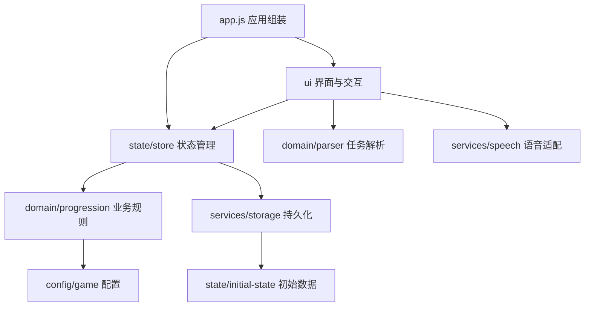

# 架构说明

## 设计选择

项目采用原生 ES Modules 分层组织。HTML 保留静态页面骨架；CSS 按职责拆分；JavaScript 通过显式 import/export 建立依赖。没有引入前端框架、打包工具或后端，适合当前单页原型规模。

## 各层约束

| 层 | 职责 | 约束 |
| --- | --- | --- |
| config | 数据型配置 | 不操作 DOM 或存储 |
| domain | 解析、任务和成长规则 | 不依赖浏览器 API；函数只操作参数 |
| state | 保存应用状态、调用业务规则、通知订阅者 | 不操作 DOM；通过注入的 storage 持久化 |
| services | 封装 localStorage、SpeechRecognition | 不依赖 UI；可注入替身测试 |
| ui | DOM 渲染、面板草稿、交互和动画 | 通过 Store 动作提交持久状态，不能修改状态快照 |
| app | 组装依赖、绑定顶层事件、把业务事件转为反馈 | 不承载 XP、徽章等规则 |

`storage.js` 使用初始状态工厂恢复不可用的数据；工厂独立于 Store，不构成循环依赖。Store 只通过注入对象访问存储。`render.js` 使用只读的查询函数计算等级和日期显示。

## 数据流

以完成任务为例：

1. `app.js` 通过列表事件委托取得任务 ID，调用 `store.completeTask(id)`。
2. Store 把内部状态交给 `domain/progression.js`，更新任务、XP、徽章和周记录。
3. 业务函数返回事件数据，如 `task-completed`、`badge`、`level-up`。
4. Store 尝试保存，随后通知订阅者，提供状态快照、事件和 `{ saved }` 保存结果。
5. `app.js` 调用 `render(state)` 刷新界面，再展示浮动 XP、徽章提示和升级动画。

存储失败不会撤销本次内存变更。目前 UI 未显示保存失败提示；以后可以使用订阅回调第三个参数实现。

## 状态与副作用

- Store 是持久状态的唯一所有者；`getState()` 返回深拷贝，业务函数内部采用可变更新。
- 页签、引导页索引、输入草稿、麦克风实例和定时器属于临时 UI/服务状态，不写入 localStorage。
- `talk.js` 在关闭面板、手动解析和重新打开时取消示例计时器与识别，避免旧回调覆盖新草稿。
- `speech.js` 对外只提供文本与识别结束回调，不包含任务解析或 DOM 操作。
- 重置会取消待执行的升级和徽章反馈，并关闭输入、引导和升级面板。

## 样式结构

`style.css` 是唯一 HTML 样式入口，按顺序导入基础、布局、组件、遗留展示、无障碍与辅助样式。颜色和字体统一使用 `base.css` 中的 CSS 变量；暗色主题沿用系统偏好和 `data-theme` 选择器。

本次拆分保留了原有选择器与视觉参数。原文件中未使用的概念展示样式单独保存在 `legacy-dossier.css`，可在明确放弃对应展示内容后删除其导入及文件。HTML 不做运行时模板拆分，避免增加加载流程。

## 后续演进

增加功能时先确定数据与业务规则，再添加 Store 动作和 UI。若后续接入服务器，可新增 API 服务并调整 Store 的加载/保存流程；当前 Store 为同步接口，不能直接替换成返回 Promise 的存储实现。页面与团队规模增长后，再考虑框架或构建工具。
